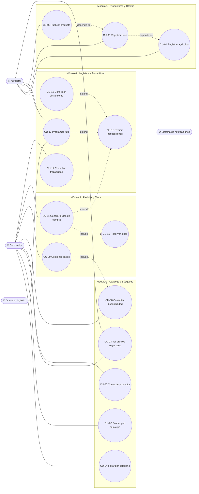
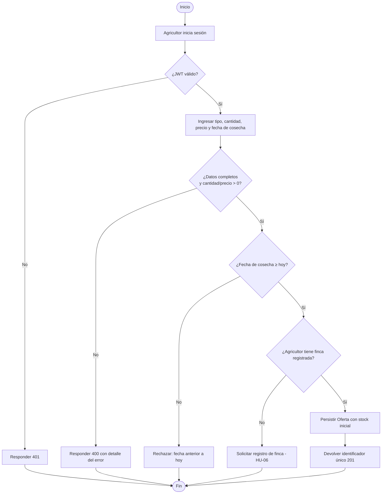
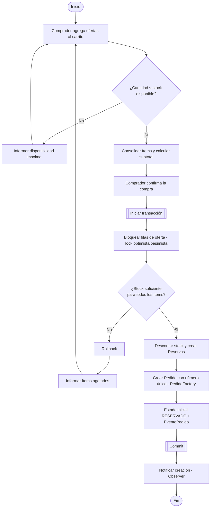
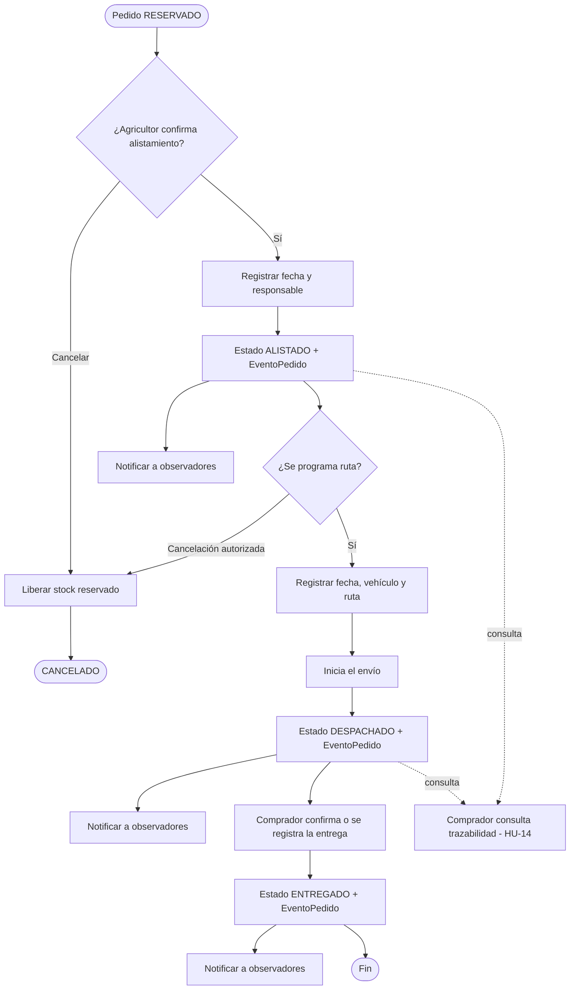

# 1. Diagrama de casos de uso

## Actores

| Actor | Descripción |
|---|---|
| **Agricultor** | Productor del Valle del Cauca que registra finca, publica oferta y alista pedidos. |
| **Comprador** | Cliente urbano (Cali y alrededores) que consulta el catálogo y compra. |
| **Operador logístico** | Programa rutas y despachos. Un agricultor también puede asumir este rol (HU-13). |
| **Sistema de notificaciones** | Actor secundario que entrega los avisos de cambio de estado (HU-15). |

## Diagrama

## Especificación resumida de casos de uso

| CU | HU | Actor | Precondición | Flujo principal | Postcondición |
|---|---|---|---|---|---|
| CU-01 | HU-01 | Agricultor | Cédula válida, municipio del Valle | Envía nombre, municipio y cédula → el sistema valida → persiste | Agricultor creado (`201 Created`) |
| CU-02 | HU-02 | Agricultor | Autenticado (JWT), finca registrada | Ingresa tipo, cantidad, precio y fecha de cosecha → valida (fecha ≥ hoy) | Oferta publicada con id único |
| CU-03 | HU-03 | Usuario | — | Solicita producto → el sistema promedia transacciones de 24 h | Precio promedio en COP |
| CU-04 | HU-04 | Comprador | Existen ofertas categorizadas | Selecciona categoría | Solo ofertas de esa categoría y disponibles |
| CU-05 | HU-05 | Comprador | Oferta con productor asociado | Pulsa "Contactar productor" | Canal de contacto habilitado, sin datos internos |
| CU-06 | HU-06 | Agricultor | Autenticado | Ingresa nombre de finca y municipio | Finca asociada al agricultor |
| CU-07 | HU-07 | Comprador | — | Filtra por municipio | Ofertas del municipio (lista vacía si no hay) |
| CU-08 | HU-08 | Comprador | Oferta publicada | Consulta la oferta | Stock actual visible; no se permite reservar más |
| CU-09 | HU-09 | Comprador | Autenticado | Agrega ofertas al carrito | Ítems consolidados con subtotal |
| CU-10 | HU-10 | Comprador | Carrito con stock suficiente | Confirma compra | Stock reservado en transacción |
| CU-11 | HU-11 | Comprador | Reservas válidas | Confirma pedido | Pedido con número único y estado `RESERVADO` |
| CU-12 | HU-12 | Agricultor | Pedido `RESERVADO` | Confirma alistamiento | Pedido `ALISTADO` con fecha y responsable |
| CU-13 | HU-13 | Agricultor/Operador | Pedido `ALISTADO` | Registra fecha, vehículo y ruta | Despacho guardado; pedido `DESPACHADO` al iniciar envío |
| CU-14 | HU-14 | Comprador | Pedido con eventos | Consulta seguimiento | Secuencia de estados con fecha/hora |
| CU-15 | HU-15 | Usuario | Pedido cambia de estado | (automático) Observer notifica | Notificación entregada |

# 2. Diagramas de actividad

## ACT-01 — Publicación de un producto (HU-02)

## ACT-02 — Compra: carrito, reserva de stock y orden (HU-09, HU-10, HU-11)

## ACT-03 — Ciclo de vida del pedido: alistamiento, despacho y trazabilidad (HU-12 a HU-15)

