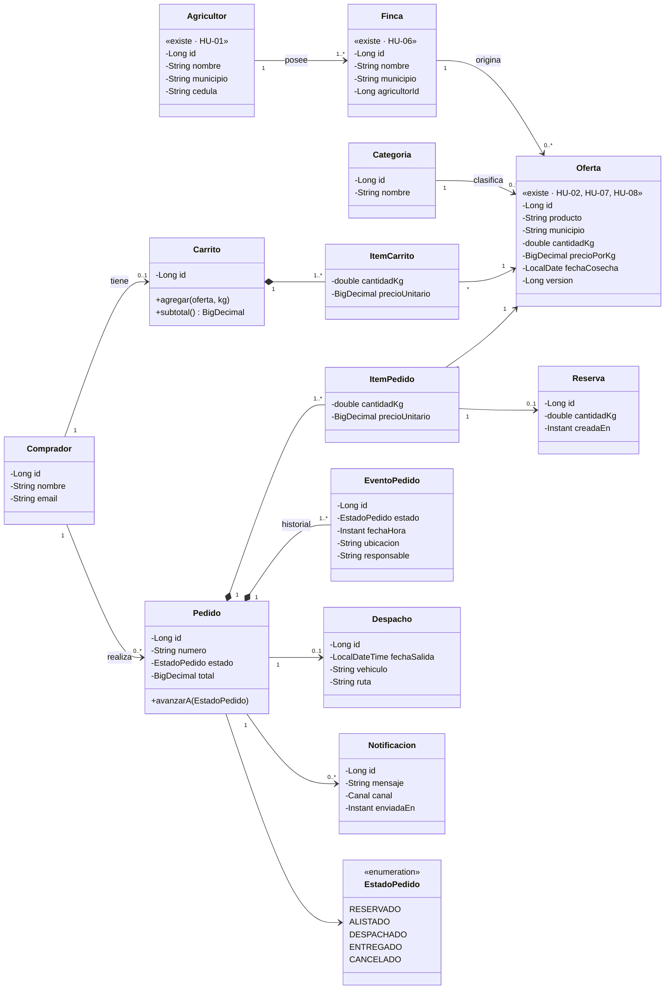
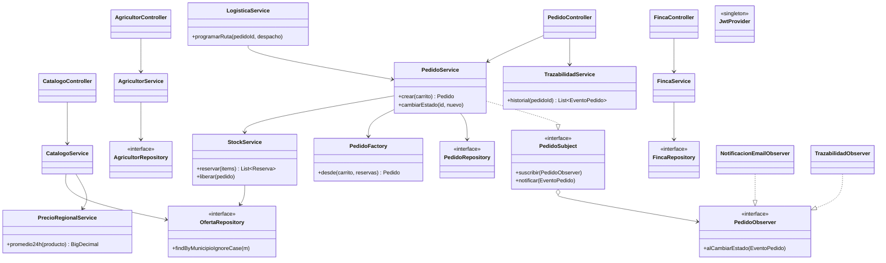

# 3. Diagrama de clases

Las clases marcadas con `«existe»` ya están implementadas en el Sprint 1 (`model/`, `service/`, `repository/`). El resto es diseño objetivo para los siguientes Sprints.

## 3.1 Modelo de dominio

> **Nota de evolución:** hoy `Finca.agricultorId` y `Oferta.municipio` son campos simples. En los Sprints siguientes se migran a relaciones JPA (`@ManyToOne Agricultor`, `@ManyToOne Finca`), y el `municipio` de la oferta se deriva de la finca. `Oferta.cantidadKg` se interpreta como stock disponible.

## 3.2 Capas, servicios y patrones

