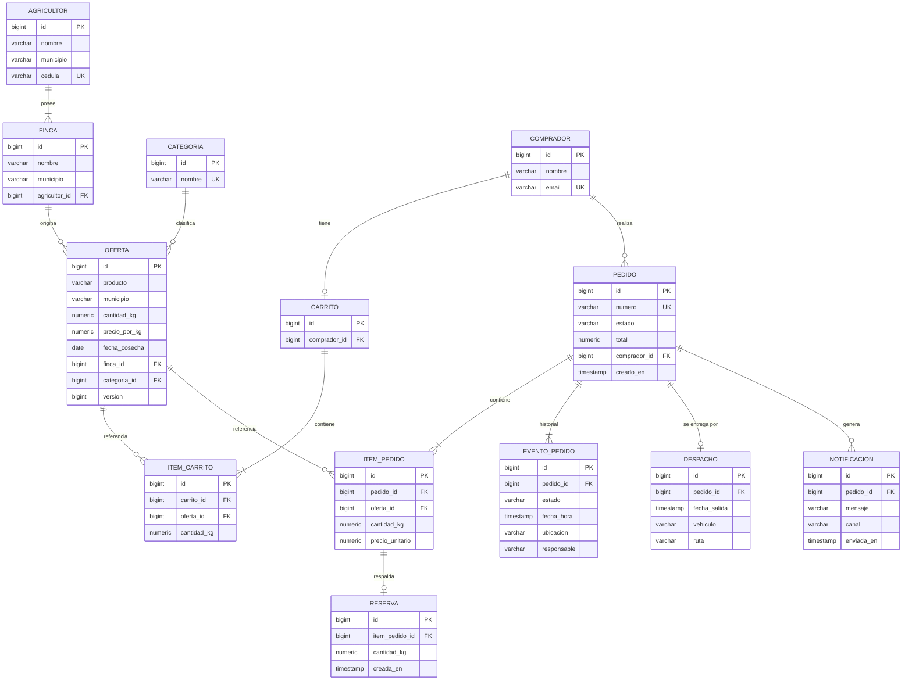

# 7. Modelo de datos (E-R lógico, PostgreSQL)

## Reglas de integridad

- `cedula` única por agricultor; `email` único por comprador.
- `cantidad_kg >= 0` en `OFERTA` (CHECK) para impedir stock negativo.
- `PEDIDO.estado` ∈ {`RESERVADO`, `ALISTADO`, `DESPACHADO`, `ENTREGADO`, `CANCELADO`}.
- `OFERTA.version` habilita bloqueo optimista (ver [ADR-004](../adr/ADR-004-control-concurrencia-stock.md)).
- Contraseñas (cuando se agregue autenticación) se almacenan solo con hash.

