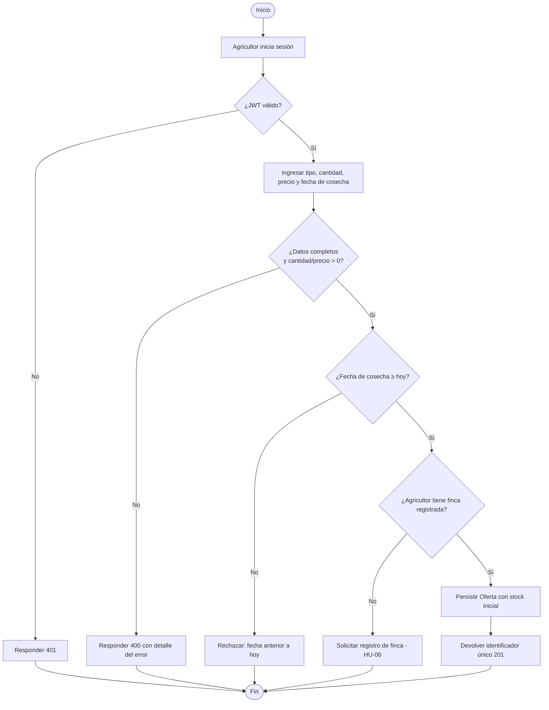
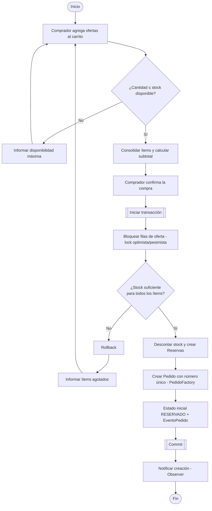
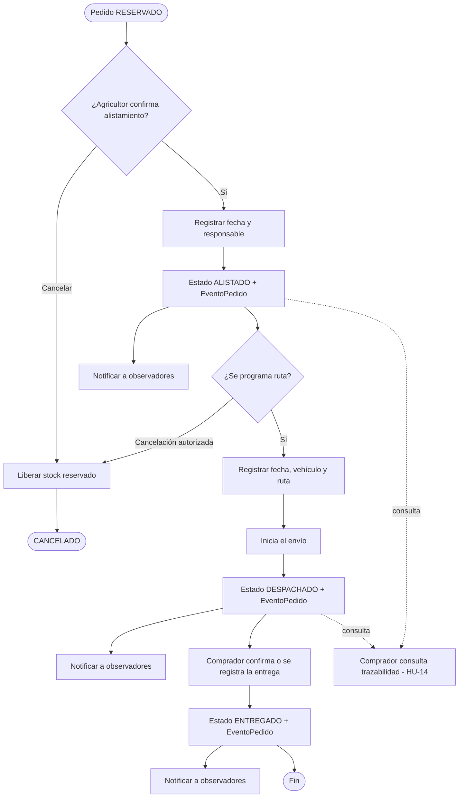

# 2. Diagramas de actividad

## ACT-01 — Publicación de un producto (HU-02)

## ACT-02 — Compra: carrito, reserva de stock y orden (HU-09, HU-10, HU-11)

## ACT-03 — Ciclo de vida del pedido: alistamiento, despacho y trazabilidad (HU-12 a HU-15)

