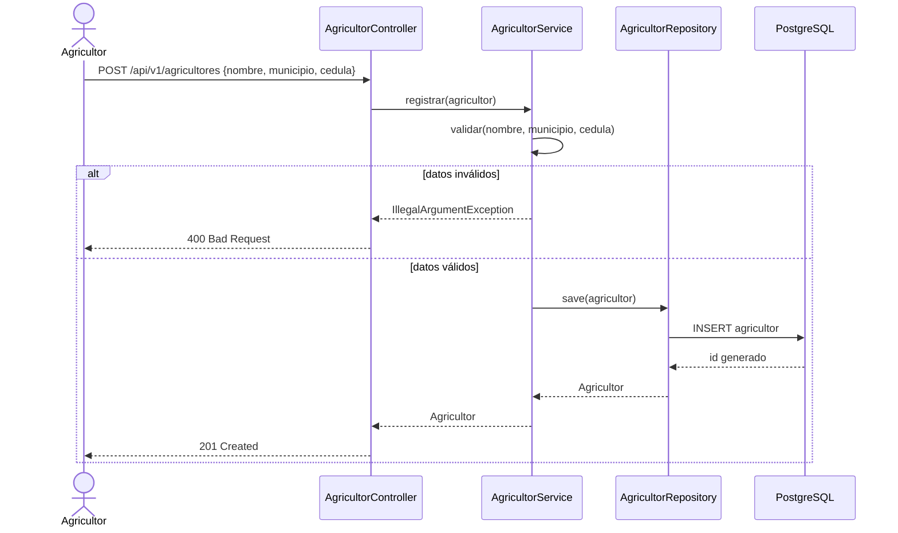
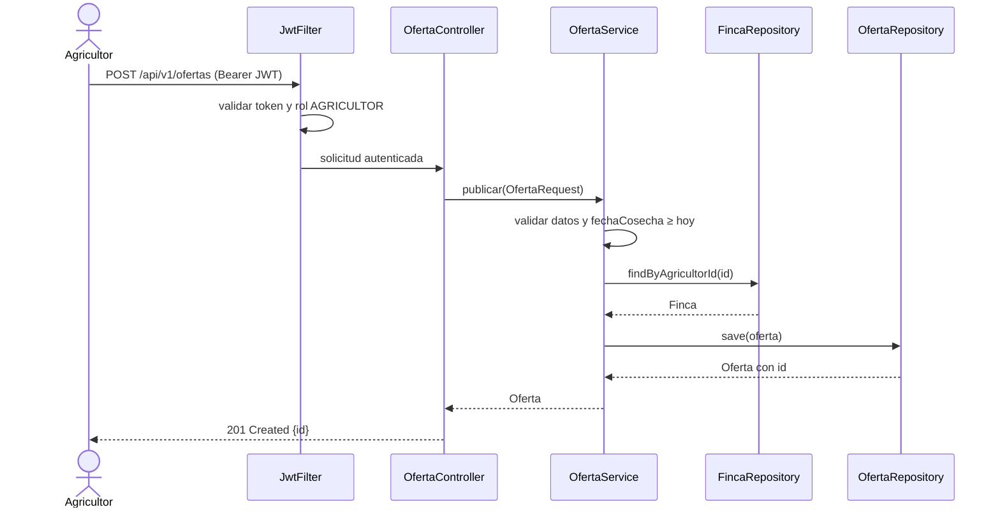
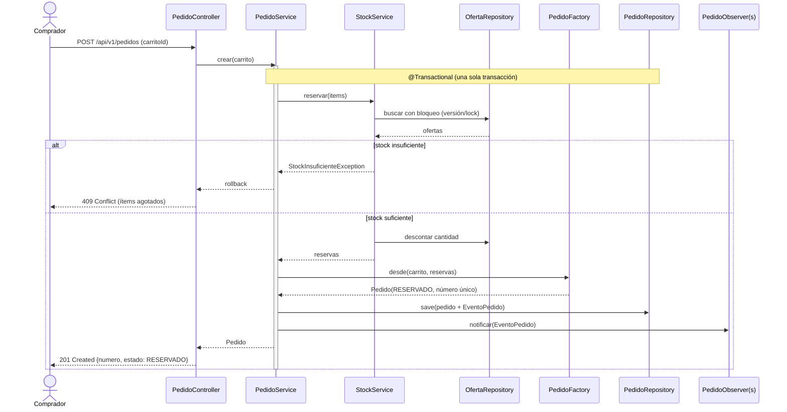
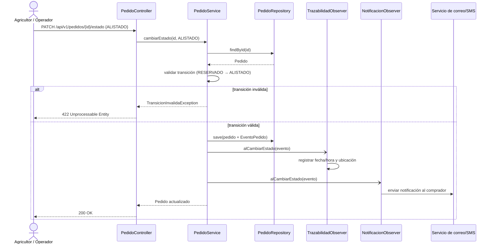
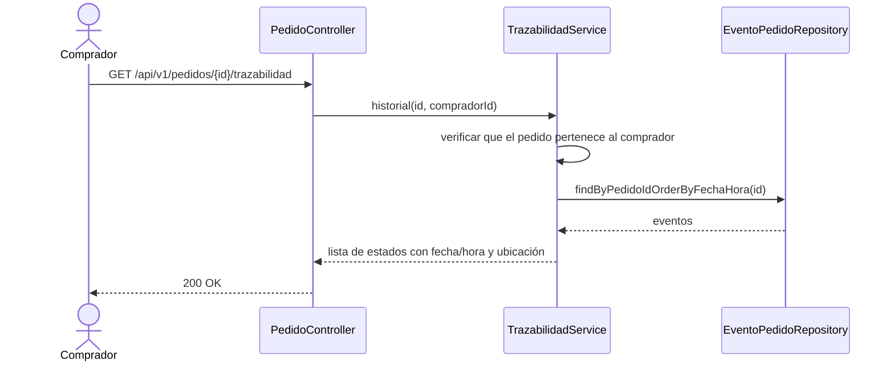

# 4. Diagramas de secuencia

## SEQ-01 — Registro de agricultor (HU-01, implementado)

## SEQ-02 — Publicación de oferta (HU-02)

## SEQ-03 — Confirmación de compra: reserva de stock y orden (HU-10, HU-11)

## SEQ-04 — Cambio de estado del pedido con notificación (HU-12, HU-13, HU-15)

## SEQ-05 — Consulta de trazabilidad (HU-14)

