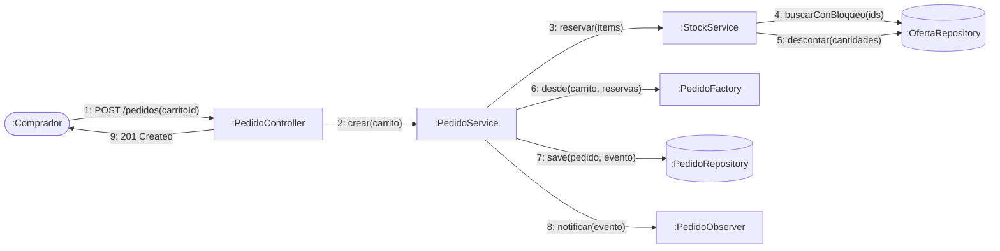

# 5. Diagrama de colaboración (comunicación)

Muestra los mismos objetos que SEQ-03 (confirmación de compra, HU-10/HU-11) pero organizados por sus vínculos; el orden de los mensajes se indica con números.

### Mensajes

| # | Emisor → Receptor | Mensaje | Respuesta |
|---|---|---|---|
| 1 | Comprador → PedidoController | `POST /api/v1/pedidos` | — |
| 2 | PedidoController → PedidoService | `crear(carrito)` | `Pedido` |
| 3 | PedidoService → StockService | `reservar(items)` | `List<Reserva>` |
| 4 | StockService → OfertaRepository | consulta con bloqueo | ofertas |
| 5 | StockService → OfertaRepository | actualización de stock | — |
| 6 | PedidoService → PedidoFactory | `desde(carrito, reservas)` | `Pedido(RESERVADO)` |
| 7 | PedidoService → PedidoRepository | `save` | pedido persistido |
| 8 | PedidoService → PedidoObserver | `notificar(evento)` | — |
| 9 | PedidoController → Comprador | `201 Created` | — |
