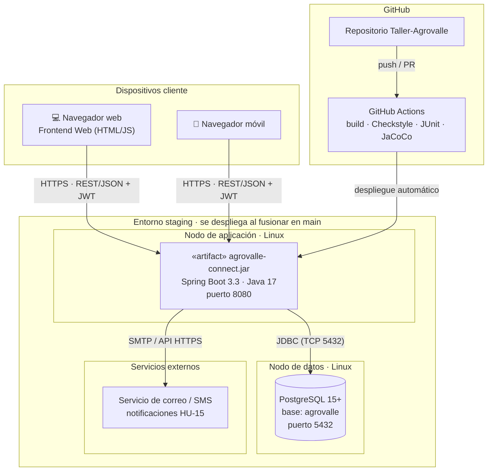

# 6. Diagrama de despliegue físico

## Nodos y configuración

| Nodo | Tecnología | Configuración (variables de entorno) |
|---|---|---|
| Cliente | Navegador moderno | — |
| Aplicación | JVM 17 + Spring Boot | `DB_URL`, `DB_USER`, `DB_PASSWORD`, `JWT_SECRET` |
| Base de datos | PostgreSQL 15+ | Usuario `agrovalle`; credenciales fuera del código |
| CI/CD | GitHub Actions (`.github/workflows/ci-cd.yml`) | Build + Checkstyle + pruebas en push/PR a `main` y `develop` |

> Los secretos nunca se versionan: se inyectan por variables de entorno (ver `application.yml`).
