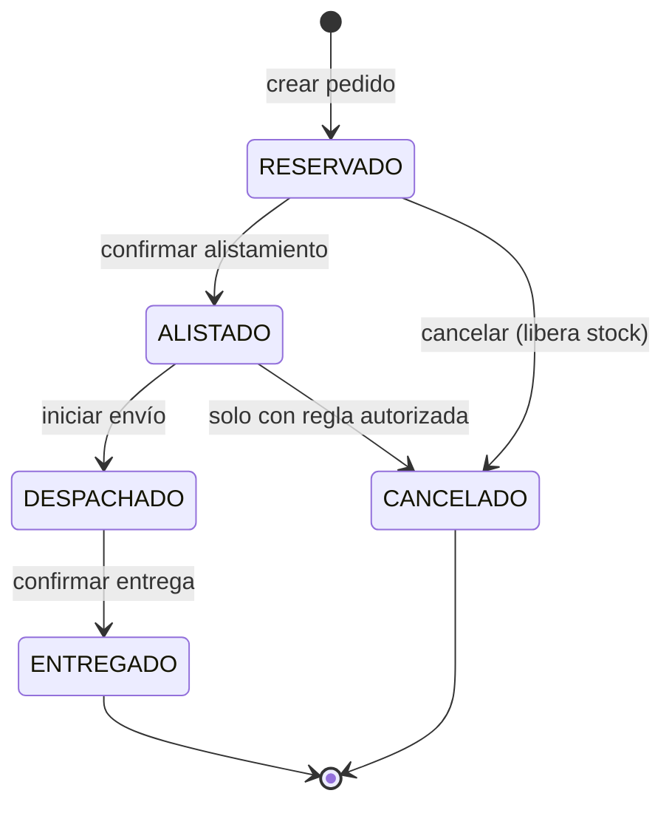

# 8. Patrones de diseño

| Patrón | Dónde se aplica | Problema que resuelve | Estado |
|---|---|---|---|
| **Repository** | `AgricultorRepository`, `FincaRepository`, `OfertaRepository`, `PedidoRepository` (Spring Data JPA) | Aísla la lógica de negocio del acceso a datos; facilita pruebas con mocks. | Implementado en Sprint 1 |
| **Factory** | `PedidoFactory.desde(carrito, reservas)` | Centraliza la creación de `Pedido` (número único, estado inicial `RESERVADO`, primer `EventoPedido`, total). | Diseñado |
| **Observer** | `PedidoSubject` / `PedidoObserver` con `TrazabilidadObserver` y `NotificacionObserver` | Cada transición de estado notifica a varios interesados sin acoplar `PedidoService` a ellos (HU-14, HU-15). | Diseñado |
| **Singleton** | `JwtProvider` y `PrecioRegionalService` (cálculo/caché de promedios) como beans de Spring (alcance singleton) | Una única instancia compartida con configuración y caché consistentes. | Diseñado |

## Factory — `PedidoFactory`

```java
@Component
public class PedidoFactory {
    public Pedido desde(Carrito carrito, List<Reserva> reservas) {
        Pedido pedido = new Pedido(generarNumero(), EstadoPedido.RESERVADO);
        carrito.getItems().forEach(i -> pedido.agregarItem(i.getOferta(), i.getCantidadKg(), i.getPrecioUnitario()));
        pedido.registrarEvento(EstadoPedido.RESERVADO, "Pedido creado");
        return pedido;
    }
}
```

## Observer — notificación en cada transición

```java
public interface PedidoObserver {
    void alCambiarEstado(EventoPedido evento);
}

// PedidoService mantiene List<PedidoObserver> (Spring inyecta todos los beans)
private void notificar(EventoPedido evento) {
    observers.forEach(o -> o.alCambiarEstado(evento));
}
```

Agregar un canal nuevo (por ejemplo WhatsApp) equivale a crear un nuevo `PedidoObserver`, sin modificar `PedidoService` (principio abierto/cerrado).

## Máquina de estados del pedido



Cada transición válida genera un `EventoPedido` y dispara el Observer. Cualquier otra transición lanza `TransicionInvalidaException`.
