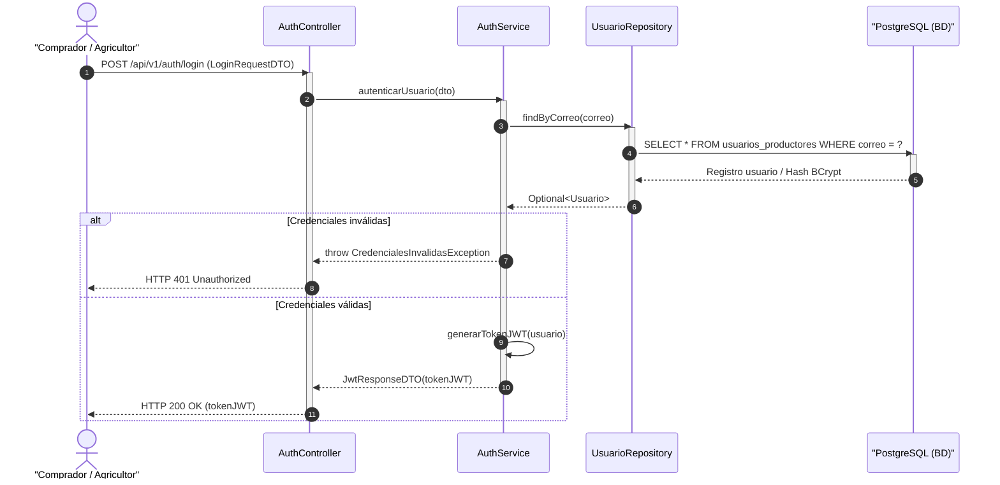
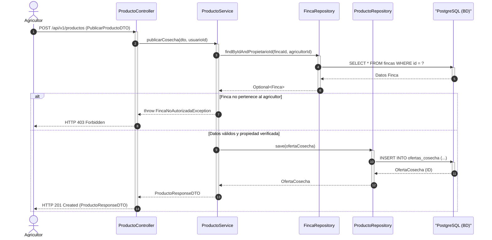
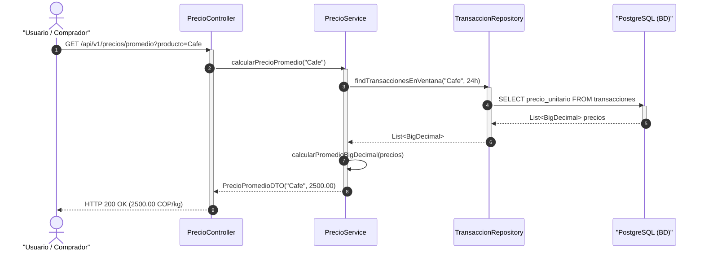
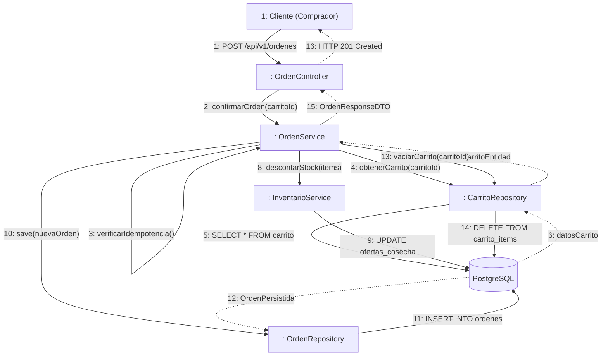
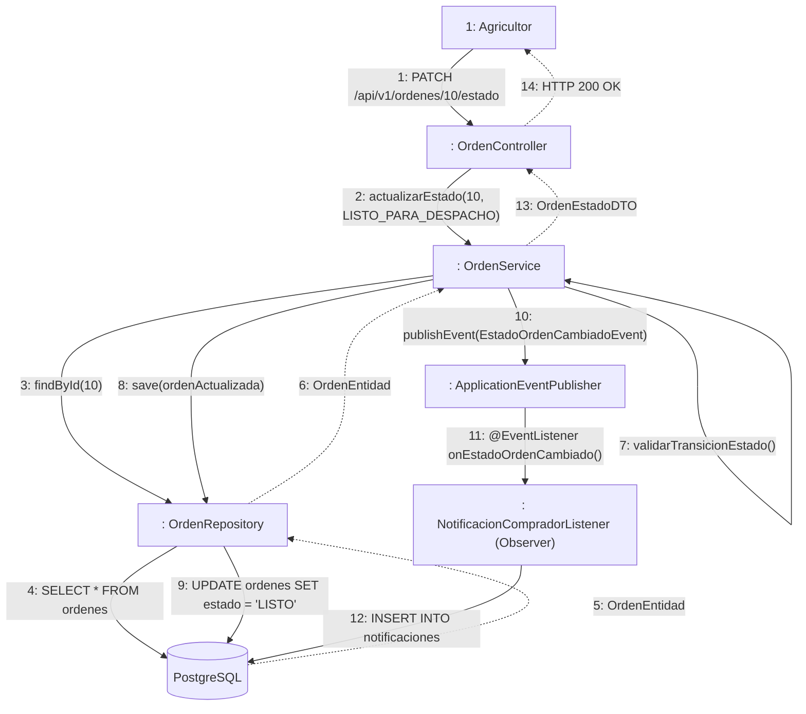
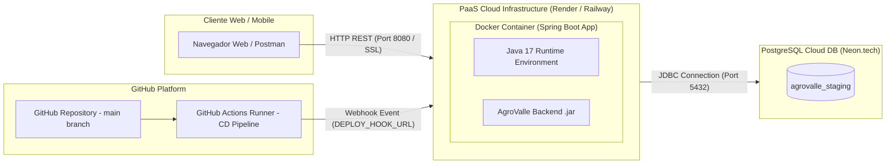

# Arquitectura y Diagramación UML - AgroValle Connect

> **Decisión Arquitectónica Relacionada:** [ADR-001: Adopción de PaaS y GitHub Actions para Despliegue Continuo en Staging](../architecture-decisions/ADR-001-despliegue-staging-paas.md)

Documento consolidado de vistas estructurales y de comportamiento del sistema AgroValle Connect, alineado con los estándares **ISO/IEC/IEEE 29148:2018** e **ISO/IEC 25010**.

---

## 1. Diagramas de Secuencia

### 1.1 Autenticación e Inicio de Sesión JWT (HU-07)


### 1.2 Publicación de Oferta de Cosecha (HU-02)


### 1.3 Consulta de Precios Promedio Regionales (HU-03)


---

## 2. Diagramas de Colaboración / Comunicación

### 2.1 Confirmación de Orden y Reserva de Inventario (HU-12)


### 2.2 Cambio de Estado de Despacho y Notificación - Patrón Observer (HU-13)


---

## 3. Diagrama de Componentes (Arquitectura MVC en 4 Capas)
```mermaid
flowchart TB
    subgraph Presentacion["Capa de Presentación (REST API)"]
        AuthCtrl[AuthController]
        ProdCtrl[ProductoController]
        OrdCtrl[OrdenController]
        EstadoCtrl[EstadoController]
    end

    subgraph Seguridad["Capa de Seguridad & Middleware"]
        SecFilter[Spring Security Filter]
        JwtFilter[JwtAuthenticationFilter]
    end

    subgraph Negocio["Capa de Lógica de Negocio (Domain Services)"]
        AuthSrv[AuthService]
        ProdSrv[ProductoService]
        OrdSrv[OrdenService]
        FleteCtx[FleteStrategyContext]
    end

    subgraph Datos["Capa de Acceso a Datos (Spring Data JPA)"]
        UserRepo[UsuarioRepository]
        ProdRepo[ProductoRepository]
        OrdRepo[OrdenRepository]
    end

    subgraph Infra["PostgreSQL Cloud"]
        DB[(Base de Datos Staging)]
    end

    SecFilter --> JwtFilter
    JwtFilter ..> AuthCtrl
    AuthCtrl ..> AuthSrv
    ProdCtrl ..> ProdSrv
    OrdCtrl ..> OrdSrv
    OrdSrv ..> FleteCtx

    AuthSrv ..> UserRepo
    ProdSrv ..> ProdRepo
    OrdSrv ..> OrdRepo

    UserRepo --> DB
    ProdRepo --> DB
    OrdRepo --> DB
```

---

## 4. Diagrama de Despliegue Físico de Infraestructura

